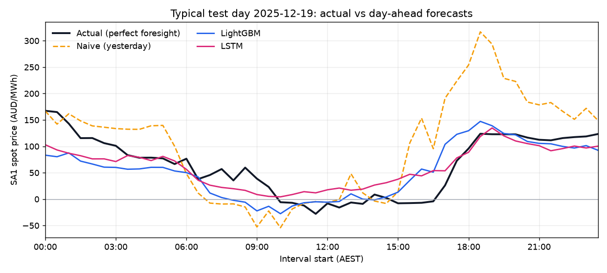

# Day-ahead price forecasting backtest (SA1)

Generated 2026-10-12 16:18 by `python -m forecasting.backtest` from `data/sa1_prices.parquet`.

## Headline

Over **365 test days** (2025-10-12 to 2026-10-11), scheduling the battery on **LSTM** forecasts captured **61.8%** of perfect-foresight arbitrage revenue, vs **27.2%** for the naive same-time-yesterday baseline. LSTM beat LightGBM (61.8% vs 49.5%).

## Data

- Source: AEMO NEMWeb aggregated price and demand, SA1 (5-min RRP averaged to 30-min; pre-Oct-2021 native 30-min)
- Range: 2019-01-01 00:00 to 2026-10-11 23:30 (2841 days, 136,368 half-hour rows), NEM market time (AEST, UTC+10, no daylight saving); intervals labelled by start
- Gaps: 0 missing and 0 partially observed half-hours. 30-min buckets are the mean of whatever 5-min observations exist (partial buckets counted above). Buckets with no observations stay NaN and are never filled in the stored data. Days with any NaN price are excluded as backtest target days; as model inputs, LightGBM takes NaN natively and the LSTM forward-fills.
- Price range: -962.20 to 20,300.00 AUD/MWh
- Open Electricity (used by the live app) only serves the last 730 days on the current plan, so history comes from AEMO NEMWeb; the same 5-minute prices were spot-checked against Open Electricity.

## Battery (fixed for every day)

- Capacity 5.0 MWh, max charge/discharge 2.5 MW, efficiency 0.9 (charging only (unchanged app LP)), starts each day empty, 0.5 h intervals.
- These are the React app's default sliders and the API's default efficiency. The LP is `calculate_optimal_dispatch()` from `main.py`, unchanged.

## Method

- Train: 2019-01-01 to 2025-07-11. Validation: 2025-07-12 to 2025-10-11 (92 days). Test: 2025-10-12 to 2026-10-11.
- Decision at the end of day D-1; all 48 half-hour prices of day D are forecast from data up to D-1 only (enforced by `tests/test_forecasting.py`).
- Expanding window: each model is retrained every 30 days on all data before the retrain date (early stopping uses the last 60 days of that training window), then forecasts each day of the block one day ahead.
- Hyperparameters, target transform / loss and training start were chosen on the validation period by capture rate, with the test period removed from the data, then frozen.
- Each test day: LP on actual prices gives perfect foresight PF_D; LP on each forecast gives a schedule which is scored at actual prices, `sum((d - c) * actual * 0.5)`. Capture rate = sum(realised) / sum(PF).

Frozen configurations:

- LightGBM: `{'transform': 'asinh', 'objective': 'l2', 'num_leaves': 63, 'train_start': '2019-01-01'}`
- LSTM: `{'transform': 'asinh', 'loss': 'mse', 'hidden': 64}`

## Results (test period)

Z = 365 days. Perfect-foresight revenue over the period: $560,314.

| Model | Capture rate | Realised revenue (AUD) | MAE (AUD/MWh) | RMSE (AUD/MWh) | Days with a loss |
|---|---:|---:|---:|---:|---:|
| Naive (yesterday) | 27.2% | 152,353 | 80.0 | 584.1 | 85 |
| LightGBM | 49.5% | 277,312 | 57.8 | 417.2 | 32 |
| LSTM | 61.8% | 346,394 | 51.2 | 413.9 | 28 |

Capture rate by quarter:

| Quarter | Days | Perfect foresight (AUD) | Naive | LightGBM | LSTM |
|---|---:|---:|---:|---:|---:|
| 2025Q4 | 81 | 100,628 | 34.9% | 54.0% | 59.3% |
| 2026Q1 | 90 | 250,285 | 24.4% | 45.5% | 67.6% |
| 2026Q2 | 91 | 123,472 | 29.8% | 58.8% | 62.4% |
| 2026Q3 | 92 | 73,280 | 23.5% | 43.5% | 49.1% |
| 2026Q4 | 11 | 12,649 | 16.2% | 35.8% | 35.2% |

Validation results (used for selection; test period not involved):

| Model | Config | Val capture | Val MAE |
|---|---|---:|---:|
| Naive (yesterday) (chosen) | `{}` | 40.3% | 64.9 |
| LightGBM (chosen) | `{'transform': 'asinh', 'objective': 'l2', 'num_leaves': 63, 'train_start': '2019-01-01'}` | 61.2% | 52.7 |
| LightGBM | `{'transform': 'asinh', 'objective': 'l2', 'num_leaves': 15, 'train_start': '2019-01-01'}` | 60.7% | 52.7 |
| LightGBM | `{'transform': 'identity', 'objective': 'huber', 'num_leaves': 63, 'train_start': '2019-01-01'}` | 60.1% | 53.7 |
| LightGBM | `{'transform': 'asinh', 'objective': 'l2', 'num_leaves': 63, 'train_start': '2021-10-01'}` | 59.8% | 53.1 |
| LightGBM | `{'transform': 'identity', 'objective': 'huber', 'num_leaves': 63, 'train_start': '2021-10-01'}` | 58.5% | 52.7 |
| LightGBM | `{'transform': 'asinh', 'objective': 'l2', 'num_leaves': 15, 'train_start': '2021-10-01'}` | 57.2% | 53.9 |
| LightGBM | `{'transform': 'identity', 'objective': 'l2', 'num_leaves': 15, 'train_start': '2021-10-01'}` | 56.1% | 64.1 |
| LightGBM | `{'transform': 'identity', 'objective': 'l2', 'num_leaves': 15, 'train_start': '2019-01-01'}` | 56.1% | 65.4 |
| LightGBM | `{'transform': 'identity', 'objective': 'huber', 'num_leaves': 15, 'train_start': '2019-01-01'}` | 55.7% | 54.0 |
| LightGBM | `{'transform': 'identity', 'objective': 'huber', 'num_leaves': 15, 'train_start': '2021-10-01'}` | 54.3% | 53.6 |
| LightGBM | `{'transform': 'identity', 'objective': 'l2', 'num_leaves': 63, 'train_start': '2019-01-01'}` | 51.2% | 67.5 |
| LightGBM | `{'transform': 'identity', 'objective': 'l2', 'num_leaves': 63, 'train_start': '2021-10-01'}` | 43.3% | 78.7 |
| LSTM (chosen) | `{'transform': 'asinh', 'loss': 'mse', 'hidden': 64}` | 66.4% | 45.0 |
| LSTM | `{'transform': 'asinh', 'loss': 'mse', 'hidden': 32}` | 65.8% | 46.2 |
| LSTM | `{'transform': 'identity', 'loss': 'huber', 'hidden': 64}` | 65.5% | 47.4 |
| LSTM | `{'transform': 'identity', 'loss': 'huber', 'hidden': 32}` | 64.2% | 48.6 |
| LSTM | `{'transform': 'identity', 'loss': 'mse', 'hidden': 64}` | 53.2% | 59.7 |
| LSTM | `{'transform': 'identity', 'loss': 'mse', 'hidden': 32}` | 49.3% | 67.4 |

## Typical test day

2025-12-19 is the test day whose perfect-foresight profit ($786) is closest to the median. Realised that day: naive $354, LightGBM $477, LSTM $539.

## Limitations

This is a single small battery acting as a price taker in one region (SA1) on energy arbitrage only: no FCAS, no network losses, no degradation cost and no cycling limit. The LP is the app's unchanged formulation, so efficiency is applied on charge only, the battery starts every day empty with no end-of-day state-of-charge target, and it may charge and discharge in the same interval (which burns energy when prices are negative). Prices are 30-minute averages of the 5-minute settlement price, so intra-half-hour spikes are smoothed out and the true opportunity is larger than measured. The schedule is fixed once per day at the end of D-1 and never re-optimised intraday, whereas a real operator rebids through the day using AEMO pre-dispatch forecasts, demand, weather and interconnector data, none of which are used here (features are lagged prices and calendar only). Forecasts are point forecasts with no uncertainty, so the schedule cannot hedge against spikes. Results come from one 365-day test window. SA1 revenue is dominated by a few extreme-price days, so the capture rate moves a lot from quarter to quarter (table above) and should be read as indicative rather than precise.
